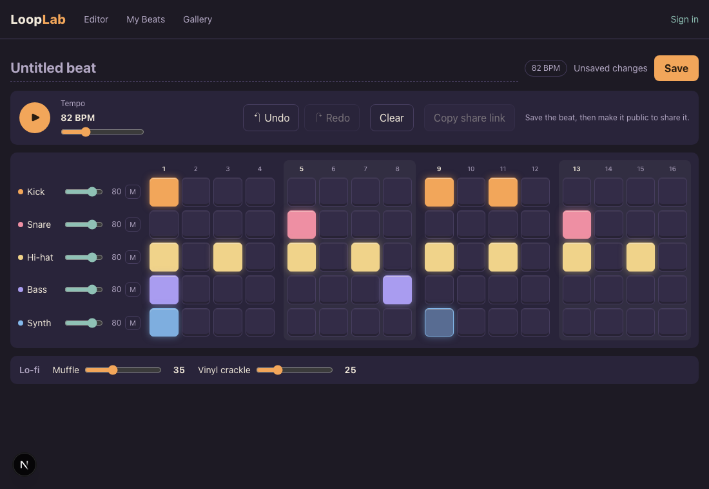
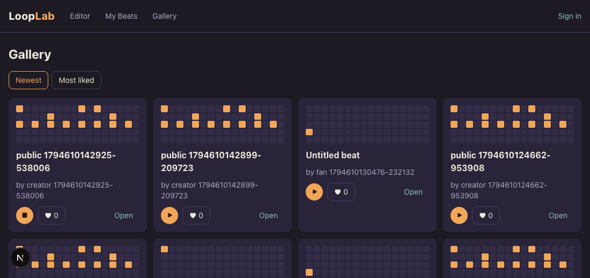
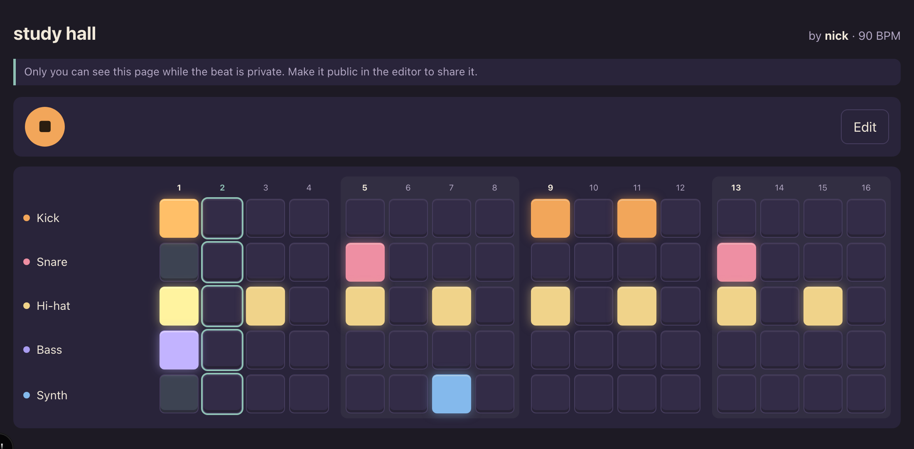
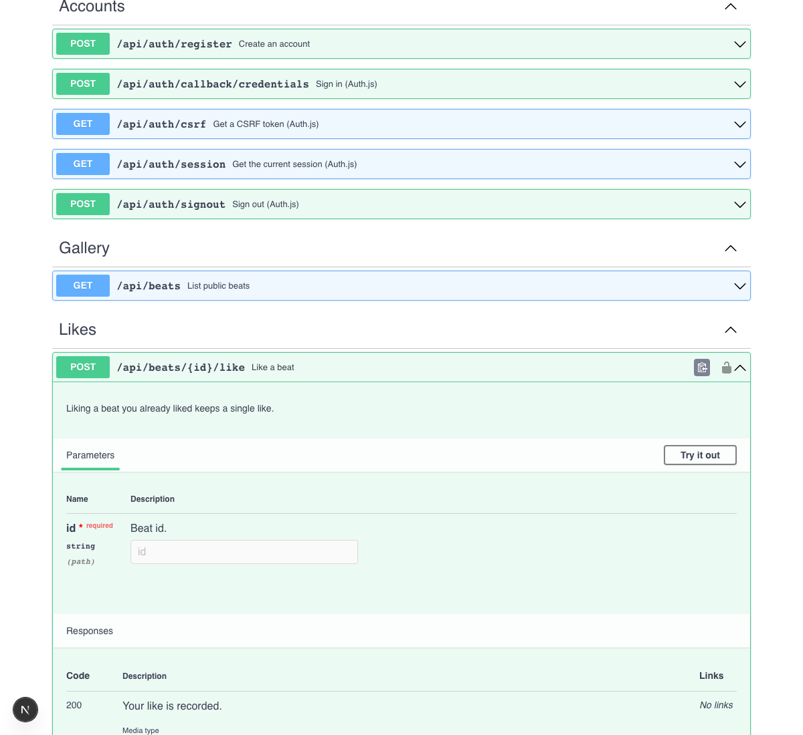

# LoopLab

A browser-based lo-fi beat maker. Toggle steps on a 5x16 grid, press play, shape the sound with lo-fi effects, then save your beat, share it by link, and remix other people's beats. No music training or install needed.

**Live:** https://looplab-sand.vercel.app · **API docs:** https://looplab-sand.vercel.app/api-docs

CS6983 AI Coding, Fall 2026, Project 2. Team: Kishan Kumar Selvakumar Anandraj and Nicholas Kaplun.



## Features

| Feature | User story | What you can do |
|---|---|---|
| **Step grid** | US-2 | 5 rows (kick, snare, hi-hat, bass, synth) by 16 steps, grouped in 4s. Works with mouse, keyboard, and screen readers |
| **Playback** | US-2 | Play/stop (or Space), a moving playhead, and tempo from 60 to 140 BPM. Edits are heard on the next loop, without restarting |
| **Shape the sound** | US-3 | Per-row volume and mute, muffle (low-pass filter), and vinyl crackle, all live while playing |
| **Undo and redo** | US-3 | Buttons or Cmd/Ctrl+Z and Cmd/Ctrl+Shift+Z. Dragging a slider counts as one change |
| **Accounts** | US-1 | Register and sign in with email and password. Anyone can use the editor; saving needs an account, and a signed-out Save keeps the beat |
| **My Beats** | US-4 | Save, open, rename, and delete beats. New beats are private; one switch makes a beat public |
| **Share links** | US-5 | Every public beat has a listen-only page at `/b/{id}` that plays it exactly as saved. Private beats show "not found" to everyone else |
| **Gallery** | US-6 | Browse public beats by newest or most liked, preview one in place, and like it |
| **Remix** | US-6 | Copy a public beat into your own private beat, credited "Remixed from {title} by {creator}" |
| **Public API** | US-7 | Every endpoint documented in OpenAPI 3.1, with interactive docs at `/api-docs` |

| Gallery | Share page | API docs |
|---|---|---|
|  |  |  |

## Tech stack

| Layer | What we use |
|---|---|
| Frontend | Next.js 16 (App Router), React 19, Tailwind CSS 4, TypeScript |
| Audio | Tone.js (synthesized sounds, loaded on the first Play click) |
| Backend | Next.js route handlers, Zod validation, one JSON error format |
| Database | PostgreSQL (Neon in production, Docker locally) through Prisma 7 |
| Auth | Auth.js v5, email and password (bcrypt), JWT session in an HTTP-only cookie |
| Testing | Vitest + React Testing Library (unit and integration), Playwright (end-to-end), 80% coverage gate on `src/lib` |
| CI/CD | GitHub Actions (lint, typecheck, tests, build, E2E, CodeQL, npm audit, dependency review), Vercel with a preview per PR |

## Project docs

| Doc | What's in it |
|---|---|
| [docs/PRD.md](docs/PRD.md) | Requirements, user stories, acceptance criteria, data model, API |
| [docs/mockup/index.html](docs/mockup/index.html) | Clickable mockup of every screen (open in a browser) |
| [docs/architecture.md](docs/architecture.md) | System diagram, request flows, and the database schema diagram |
| [docs/openapi.yaml](docs/openapi.yaml) | API spec (interactive at [`/api-docs`](https://looplab-sand.vercel.app/api-docs)) |
| [docs/sprints/](docs/sprints/) | Sprint plans, standups, and retrospectives |
| [docs/contributions.md](docs/contributions.md) | Partner contribution log: who built and reviewed what |
| [CLAUDE.md](CLAUDE.md) | Shared AI rules file: stack, architecture, conventions, workflow |

## Run locally

```bash
npm install
npm run dev   # http://localhost:3000
```

### Local database (needed for accounts, saving, and the integration tests)

LoopLab uses PostgreSQL through Prisma. Locally, run Postgres in Docker:

```bash
docker run -d --name looplab-db -e POSTGRES_USER=looplab -e POSTGRES_PASSWORD=looplab \
  -e POSTGRES_DB=looplab -p 5433:5432 postgres:17
docker exec looplab-db psql -U looplab -c "CREATE DATABASE looplab_test;"
```

Then copy `.env.example` to `.env` (git-ignored), set `AUTH_SECRET` (`openssl rand -base64 32`), and apply the schema with `npm run db:migrate`. `npm test` applies migrations to the test database on its own; without `DATABASE_URL_TEST`, the integration tests are skipped.

| Variable | What it's for |
|---|---|
| `DATABASE_URL` | The app's Postgres database |
| `DATABASE_URL_TEST` | A separate database for integration tests (emptied between tests) |
| `AUTH_SECRET` | Signs the session cookie |

### Tests

| Command | What it runs |
|---|---|
| `npm test` | Unit + integration tests (Vitest) |
| `npm run test:coverage` | Same, with the 80% coverage gate on `src/lib` |
| `npm run test:e2e` | Browser tests (Playwright) |
| `npm run lint` / `npm run typecheck` | ESLint / TypeScript |

## CI

GitHub Actions ([`.github/workflows/ci.yml`](.github/workflows/ci.yml)) runs on every pull request and every push to `main`:

| Job | What it checks |
|---|---|
| Lint and typecheck | `npm run lint`, `npm run typecheck` |
| Unit and integration tests | `npm run test:coverage` against a throwaway Postgres, with the 80% gate on `src/lib` |
| Production build | `npm run build` |
| E2E tests | Playwright against the production build |
| Security: CodeQL | Static analysis of the JavaScript/TypeScript code; findings appear in the repo's **Security** tab |
| Security: npm audit | `npm audit --audit-level=high`: fails on high or critical vulnerabilities in any dependency |
| Security: dependency review | Pull requests only: fails if the PR adds a dependency with a high or critical vulnerability |

The first four jobs run in that order; the security scans run in parallel with them, so they don't slow them down. Run the audit locally with `npm audit --audit-level=high`.

[Dependabot](.github/dependabot.yml) opens weekly pull requests to update npm packages (minor and patch updates grouped into one PR) and the GitHub Actions the workflow uses. They go through the same CI and review as any other PR.

## Deployment

LoopLab deploys to **Vercel** with a **Neon** Postgres database.

| Environment | When | Database |
|---|---|---|
| Production | Every push to `main` | Neon main branch |
| Preview | Every pull request (Vercel comments the URL on the PR) | Its own Neon branch, created by the Neon integration |

**Production URL:** https://looplab-sand.vercel.app

How it's wired:
1. The Vercel project imports this repo; Vercel's GitHub app builds every PR and every push to `main`.
2. The Neon integration (Vercel > Storage > Neon) sets `DATABASE_URL` for Production and gives each Preview deployment its own database branch.
3. `AUTH_SECRET` is set by hand in Vercel's environment variables, separately for Production and Preview.
4. Vercel runs `npm run vercel-build` (`prisma migrate deploy && next build`), so every deploy applies pending migrations before building.
5. GitHub Actions CI (lint, tests, build, E2E, security scans; see [CI](#ci)) runs on the same PRs, independent of Vercel.

