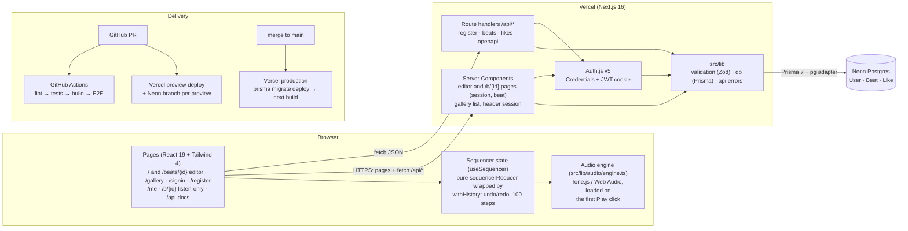
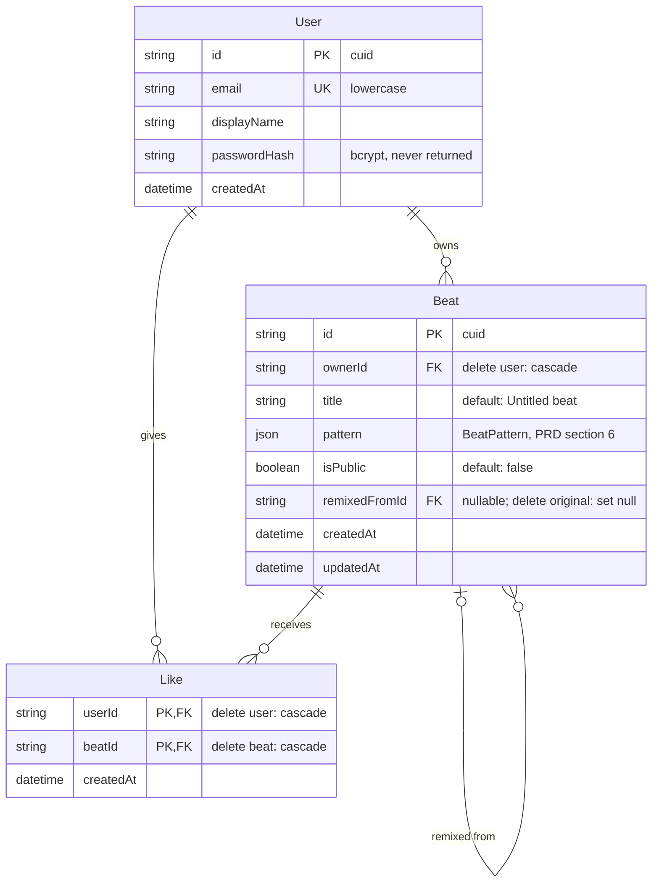

# LoopLab architecture

LoopLab is one Next.js 16 app (App Router) deployed on Vercel, backed by a Neon Postgres database. Sound is generated in the browser with Tone.js; the server only ever stores **beat patterns as JSON**, never audio.

## System diagram

Boxes marked (planned) are on the Sprint 1 or 2 board but not merged yet. A PNG copy is in [`diagrams/architecture.png`](diagrams/architecture.png).

## How a request flows

| Example | Path through the system |
|---|---|
| Open `/gallery` | Server Component reads the session (Auth.js, inside `<Suspense>`) → `listPublicBeats()` in `src/lib/db/beats.ts` → Prisma → Postgres → cards stream into the page |
| Click ♥ on a card | `LikeButton` (client) → `POST /api/beats/{id}/like` → `getCurrentUserId()` → `likeBeat()` → JSON `{ liked, likeCount }` |
| Register | `AuthForm` → `POST /api/auth/register` → Zod `registerSchema` → `createUser()` (bcrypt) → then Auth.js `signIn("credentials")` sets the JWT cookie |
| Edit and play a beat | Grid click → `useSequencer` (`sequencerReducer` wrapped by `withHistory`) → new pattern → `usePlayback` → `engine.update()`. The first Play click imports Tone.js and unlocks audio. No server involved. |
| Save a new beat | `SaveBar` → `POST /api/beats` → `createBeat()` → `history.replaceState` changes the URL to `/beats/{id}` without a navigation, so the same editor stays on screen (still playing, same undo history) and later saves `PATCH` that beat. A link back to `/` afterwards starts a new beat; Back to a `/beats/{id}` the editor isn't showing loads that beat's page. Signed out, Save keeps the beat as a draft in `localStorage`, goes to `/signin`, and the editor at `/` starts from that draft when you come back. |
| Open `/beats/{id}` | `SavedBeatEditor` (inside `<Suspense>`, after `connection()`) → `getCurrentUserId()` → `findBeat()` → the owner gets the editor, starting a fresh undo history from the saved beat; anyone else is sent to `/b/{id}` for a public beat, or gets the 404 page for a private one. |
| Make a beat public | `VisibilityToggle` (editor title bar, or a My Beats row) → `PATCH /api/beats/{id}` `{ isPublic }` → `updateBeat()` (owner only). Saved right away; not part of the undo history. |
| Copy share link | `ShareButton` (enabled only for a saved, public beat) → `navigator.clipboard.writeText("{origin}/b/{id}")` → "Link copied" toast. No server involved. |
| Open `/b/{id}` | `SharedBeat` (inside `<Suspense>`, after `connection()`) → `getCurrentUserId()` → `findBeat()` → `ListenOnlyBeat`: title, creator, tempo, Play/Stop through the same `usePlayback` and engine, and the read-only grid. A private beat gets the same not-found page as an unknown id (`src/app/b/[id]/not-found.tsx`: "This beat is private or doesn't exist", with a link to the gallery), except for its owner, who sees the beat and an Edit link. |

## The editor

- **State is one pure reducer.** `sequencerReducer` (`src/lib/sequencer/reducer.ts`) handles every edit: toggle a step, Clear, set the tempo. `withHistory()` (`src/lib/sequencer/history.ts`) wraps it with past / present / future, keeps 100 steps, and clears redo on a new change. While a slider is dragged it applies each move right away and records the whole drag as one step when you let go. Neither file uses React or browser APIs.
- **`useSequencer`** holds that state for the editor; components call `edit`, `preview` / `commit` (sliders), `undo`, and `redo` and never change state themselves. Playback and the playhead live in `usePlayback`, outside the history, so undo never stops the music.
- **Audio follows state, one way.** `usePlayback` hands each new pattern to `src/lib/audio/engine.ts`, the only file that loads Tone.js (`voices.ts` next to it uses Tone's types and builds the five synthesized instruments). Tone.js is imported on the first Play click, not when the page loads, because importing it creates an AudioContext and browsers only allow audio after a click. Timing comes from Tone's Transport, 16 steps per bar.

## Key rules (from `CLAUDE.md`)

- **Pages stay thin.** Logic lives in `src/lib/` (pure TypeScript, unit-tested) and route handlers follow one pattern: validate (Zod) → check auth/ownership → call `src/lib/db` → JSON, with errors as `{ error: { code, message } }`.
- **Only `src/lib/db` talks to Prisma; only `src/lib/audio` imports Tone.js.**
- **Private beats return 404** to non-owners, so they can't be discovered.
- **Cache Components is on** (Next.js 16): anything that reads the session or search params renders inside `<Suspense>` and calls `connection()` first.

## Database schema

Source of truth: [`prisma/schema.prisma`](../prisma/schema.prisma). Migrations in `prisma/migrations/`. PNG copy: [`diagrams/database.png`](diagrams/database.png).

**Indexes:** `User.email` (unique), `Beat(ownerId, updatedAt)` for My Beats, `Beat(isPublic, createdAt)` for the gallery, `Like(beatId)` for like counts. `Like`'s primary key `(userId, beatId)` is what enforces one like per user per beat.

**Why `pattern` is JSON instead of tables:** a beat is always loaded and saved as a whole, never queried by individual steps, so one validated JSON column is simpler and cheaper than 80 step rows per beat.
