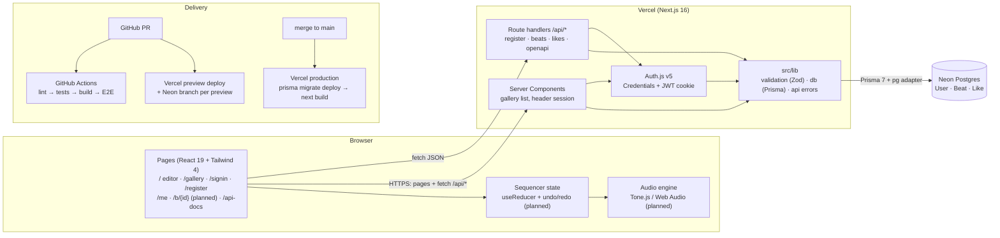
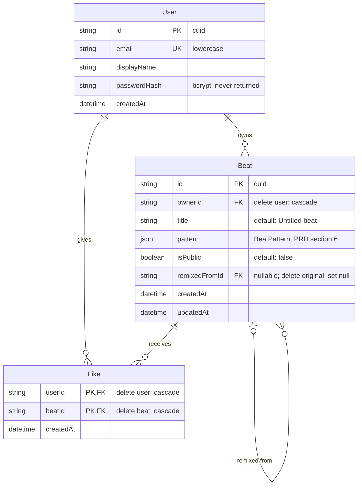

# LoopLab architecture

LoopLab is one Next.js 16 app (App Router) deployed on Vercel, backed by a Neon Postgres database. Sound is generated in the browser with Tone.js; the server only ever stores **beat patterns as JSON**, never audio.

## System diagram

Boxes marked (planned) are on the Sprint 1 or 2 board but not merged yet. A PNG copy is in [`diagrams/architecture.png`](diagrams/architecture.png).

## How a request flows

| Example | Path through the system |
|---|---|
| Open `/gallery` | Server Component reads the session (Auth.js, inside `<Suspense>`) → `listPublicBeats()` in `src/lib/db/beats.ts` → Prisma → Postgres → cards stream into the page |
| Click ♥ on a card | `LikeButton` (client) → `POST /api/beats/{id}/like` → `getCurrentUserId()` → `likeBeat()` → JSON `{ liked, likeCount }` |
| Register | `AuthForm` → `POST /api/auth/register` → Zod `registerSchema` → `createUser()` (bcrypt) → then Auth.js `signIn("credentials")` sets the JWT cookie |
| Play a beat (planned) | Grid click → `sequencerReducer` → `usePlayback` → `lib/audio/engine.ts` → Tone.js. No server involved. |

## Key rules (from `CLAUDE.md`)

- **Pages stay thin.** Logic lives in `src/lib/` (pure TypeScript, unit-tested) and route handlers follow one pattern: validate (Zod) → check auth/ownership → call `src/lib/db` → JSON, with errors as `{ error: { code, message } }`.
- **Only `src/lib/db` talks to Prisma; only `src/lib/audio` imports Tone.js.**
- **Private beats return 404** to non-owners, so they can't be discovered.
- **Cache Components is on** (Next.js 16): anything that reads the session or search params renders inside `<Suspense>` and calls `connection()` first.

## Database schema

Source of truth: [`prisma/schema.prisma`](../prisma/schema.prisma). Migrations in `prisma/migrations/`. PNG copy: [`diagrams/database.png`](diagrams/database.png).

**Indexes:** `User.email` (unique), `Beat(ownerId, updatedAt)` for My Beats, `Beat(isPublic, createdAt)` for the gallery, `Like(beatId)` for like counts. `Like`'s primary key `(userId, beatId)` is what enforces one like per user per beat.

**Why `pattern` is JSON instead of tables:** a beat is always loaded and saved as a whole, never queried by individual steps, so one validated JSON column is simpler and cheaper than 80 step rows per beat.
