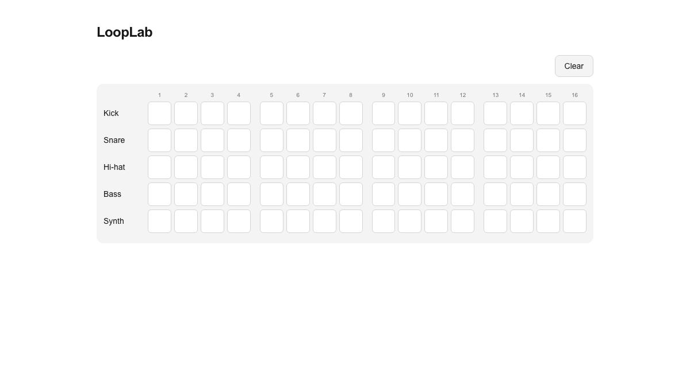
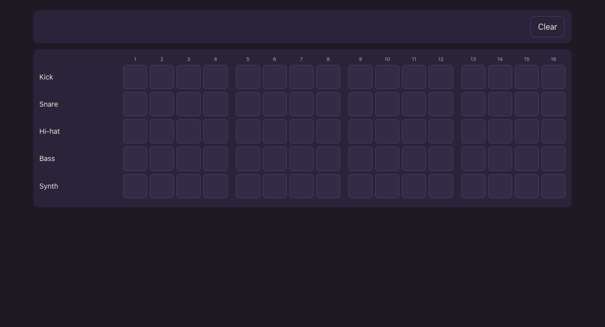

# HW3 Before/After Test: Same Feature With and Without CLAUDE.md

**Feature:** [Issue #5](https://github.com/kishankumar5/looplab/issues/5), "Toggle steps on a 5x16 step grid" (Sprint 1)
**Tool:** Claude Code 2.1.302, model `claude-opus-5-5`
**Date:** 2026-10-28

## Method

We ran the same feature three times. Each run was a brand-new Claude Code session in its own fresh clone of the repo, started from the command line (`claude -p`), with no human input during the run.

| | Run A: without rules | Run B: with rules v1 | Run C: with rules v1.1 |
|---|---|---|---|
| Starting code | `main` after PR #20 | `main` after PR #20 | `main` + CLAUDE.md v1.1 |
| `CLAUDE.md` / `AGENTS.md` | **Deleted** | Present (v1) | Present (v1.1) |
| `docs/PRD.md` and mockup | Present | Present | Present |
| Prompt | Identical (below) | Identical | Identical |
| Model, tools allowed | Same | Same | Same, plus read-only `gh issue view/list` (part of the v1.1 fix) |

**Prompt (word for word in all runs):**

> Implement this feature: a step sequencer grid with 5 instrument rows (kick, snare, hi-hat, bass, synth) and 16 steps. Clicking a cell toggles it on and off, and a Clear button turns all cells off. Include tests.

**Controls:** each clone lived outside our usual folders so no other instruction files loaded, personal (user-level) instructions and settings were turned off for every run (`--setting-sources project`), and no MCP servers were loaded (`--strict-mcp-config`). Only the project rules file differed between A and B.

**Limitation:** one run per condition, so some differences may be run-to-run variation. Run A still had the PRD and mockup in the repo, and it found and used them, so this measures what the *rules file* adds on top of good docs, not rules vs. nothing.

## Results

### Scorecard (12 checks from CLAUDE.md and issue #5; ✓ = 1, ◐ = 0.5, ✗ = 0)

| # | Check | A: without | B: with v1 | C: with v1.1 |
|---|---|---|---|---|
| 1 | Uses Vitest | ✓ | ✓ | ✓ |
| 2 | Failing tests committed before the implementation | ✗ nothing committed | ◐ test commit first, but it failed only on missing imports | ✓ failed on 21 "not implemented" assertions |
| 3 | Tests pass | ✓ 16/16 | ✓ 16/16 | ✓ 21/21 |
| 4 | Editing logic in a pure reducer in `src/lib/sequencer/` | ◐ pure functions in `src/lib/pattern.ts`, no reducer | ✓ | ✓ |
| 5 | Folder layout and naming (`components/sequencer/StepCell.tsx`, named exports) | ◐ one 87-line component, default export | ✓ | ✓ |
| 6 | Cells are `<button aria-pressed>` labeled "Kick step 5" | ✓ | ✓ | ✓ |
| 7 | Steps numbered 1 to 16 with a gap after every 4 | ✓ | ✓ | ✓ |
| 8 | Mockup colors as theme tokens, no raw hex in components | ✗ Tailwind grays + 1 raw hex | ✓ tokens in `globals.css`, 0 raw hex | ✓ |
| 9 | Track IDs are the lowercase union (`"hihat"`) | ✓ | ✓ | ✓ |
| 10 | No unwanted libraries (state libraries, UI kits) | ✓ | ✓ | ✓ |
| 11 | Lint and typecheck pass | ✓ | ✓ | ✓ |
| 12 | Branch and commit format with `(#5)` | ✗ no commits | ✓ 4 commits | ✓ 3 commits |
| | **Score** | **8 / 12** | **11.5 / 12** | **12 / 12** |

### Process measures

| | A: without | B: with v1 | C: with v1.1 |
|---|---|---|---|
| Read issue #5 | No | No (not allowed to run `gh`; guessed criteria from the PRD) | **Yes**, listed and ticked each criterion |
| Commits | 0 | 4 (`chore` → `test` → `feat` → `chore`) | 3 (`chore` → `test` → `feat`) |
| Coverage script / `src/lib` coverage | None | None | `test:coverage`, **100%** |
| Files added or changed (excluding lockfile) | 9 | 17 | 18 |
| Screenshot of the result | No | No, and didn't mention it | No, but **said so** and why (rule followed) |
| Time / agent turns / usage cost | 82 s / 15 / $0.58 | 145 s / 35 / $1.09 | 271 s / 55 / $1.45 |

**The cost of the rules:** runs B and C took about 2x and 3x as long as A. Nearly all of that extra time went to things the rules require (separate commits, running tests red before green, lint and typecheck, reading the issue). That trade is worth it for us, because TDD evidence in git history is graded and is the hardest thing to recreate after the fact.

### What it looks like

| Without rules (default light mode) | With rules (v1.1) |
|---|---|
|  |  |

Without rules, the AI used generic Tailwind grays and followed the browser's light/dark setting, so most viewers would see a white page. The mockup is dark and warm. With rules, it put the mockup's colors into theme tokens and matched the layout, including Clear in a toolbar above the grid where Play and Tempo will go. (Dark-mode and v1 screenshots are in `screenshots/`.)

### Code: the same cell, two ways

**Without rules:** cell markup lives inside one large `StepGrid` component, with raw palette classes and a hard-coded hex glow:

```tsx
<button
  type="button"
  aria-label={`${TRACK_LABELS[track]} step ${i + 1}`}
  aria-pressed={on}
  onClick={() => setSteps((s) => toggleStep(s, track, i))}
  className={`aspect-square rounded-md border p-0 ... focus-visible:outline-teal-400 ${
    on
      ? "border-orange-400 bg-orange-400 shadow-[0_0_10px_#f2a65a55]"
      : "border-zinc-300 bg-white dark:border-zinc-700 dark:bg-zinc-800"
  }`}
/>
```

**With rules:** its own `StepCell` component in `components/sequencer/`, theme tokens only, named export:

```tsx
export function StepCell({ label, on, onToggle }: StepCellProps) {
  const stateClasses = on ? "border-accent bg-accent shadow-glow" : "border-line bg-panel-2";
  return (
    <button type="button" aria-label={label} aria-pressed={on} onClick={onToggle}
      className={`aspect-square rounded-cell border p-0 focus-visible:outline-2
        focus-visible:outline-offset-2 focus-visible:outline-accent-2 ${stateClasses}`} />
  );
}
```

**With rules, state goes through the reducer that undo/redo (#12) will wrap later**, exactly as CLAUDE.md's architecture section describes:

```ts
export type SequencerAction =
  | { type: "toggleStep"; track: TrackId; step: number }
  | { type: "clear" };

export function sequencerReducer(state: BeatPattern, action: SequencerAction): BeatPattern { ... }
```

Without rules, state was a `useState` inside the grid component. That works today but would have to be rewritten for undo/redo, saving, and playback.

### Tests

| | A: without | B: with v1 | C: with v1.1 |
|---|---|---|---|
| Logic tests | 10 (`pattern.test.ts`) | 10 (`reducer.test.ts`) | 11 (`pattern.test.ts`, `reducer.test.ts`) |
| Component tests | 6 (`StepGrid.test.tsx`) | 6 (`StepGrid`, `Sequencer`) | 10 (`StepGrid`, `SequencerEditor`) |
| Tests target the shared beat format (tempo, volume, effects untouched by Clear) | No (grid only) | Yes | Yes |
| Red commit fails for the right reason | n/a | No (missing imports) | Yes (assertions) |

## Iteration: what Run B exposed and what we changed (v1 → v1.1)

| Problem seen in Run B | Change in CLAUDE.md v1.1 | Fixed in Run C? |
|---|---|---|
| "Red" test commit failed only because the code files didn't exist, which proves little | Red step now requires stub files (real exports, bodies throw "not implemented") so tests fail on assertions | **Yes**, 21/21 failed on "not implemented" |
| Couldn't open issue #5; guessed the acceptance criteria from the PRD | Step 1: read the issue with `gh issue view`; if that's impossible, stop and ask | **Yes**, read the issue and ticked each criterion |
| Lost time on a `LayoutProps` type error from plain `tsc` | Documented `typecheck = next typegen && tsc --noEmit` | **Yes**, script added in the first commit |
| No coverage script, so the 80% goal couldn't be checked | Added `@vitest/coverage-v8` and the `test:coverage` command | **Yes**, 100% on `src/lib` |
| "Ask before adding a dependency" conflicted with "include tests" when no test tools existed | Test tools are pre-approved; only other libraries need asking | **Yes**, installed and explained them without stalling |
| Never looked at the page it built | UI changes need a screenshot, or an explicit note that there isn't one | **Partly**: it tried, couldn't (permission), and reported it |

Full change log: the "Rules changelog" table at the bottom of [`CLAUDE.md`](../../CLAUDE.md).
